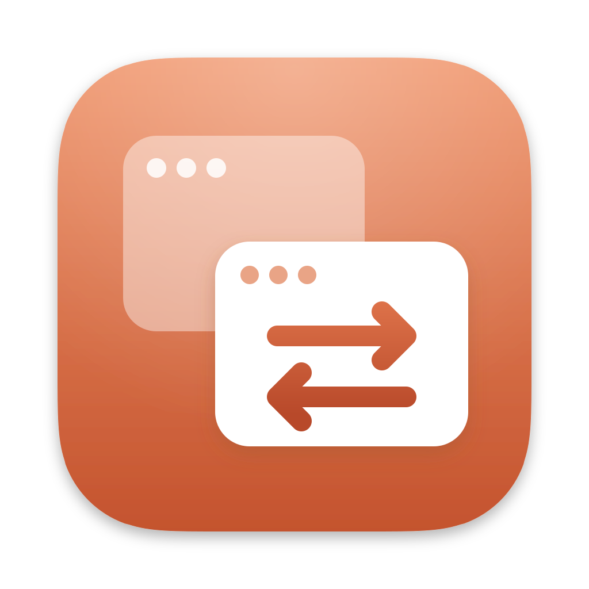
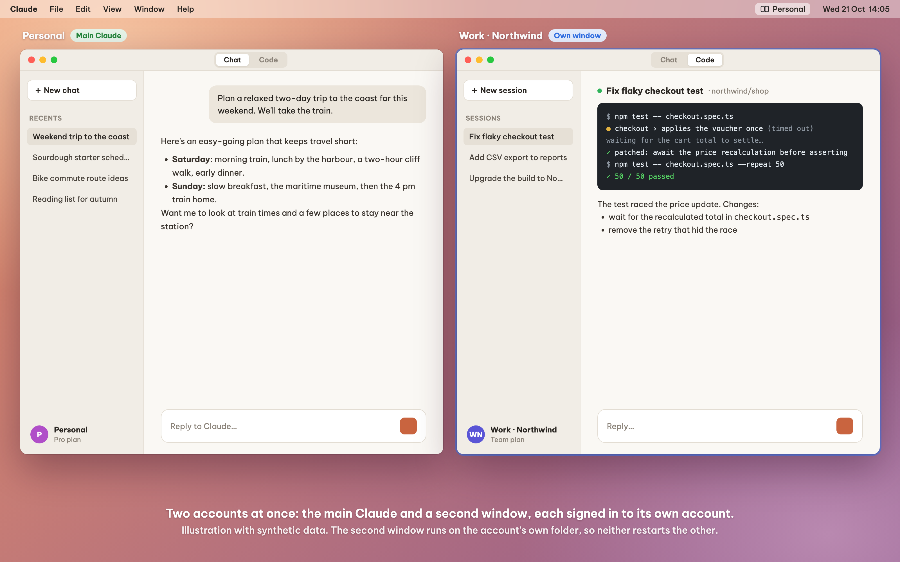
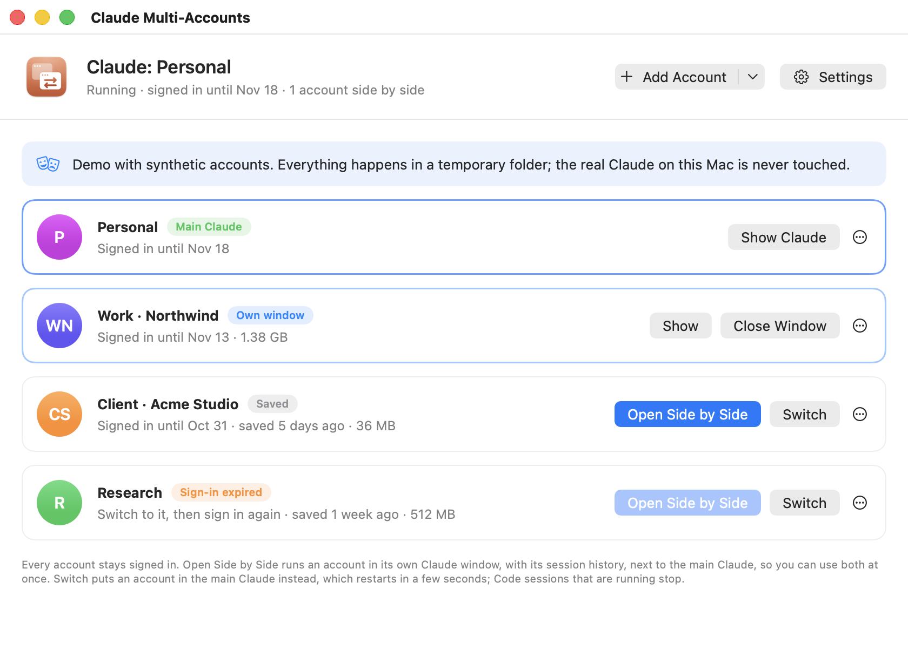
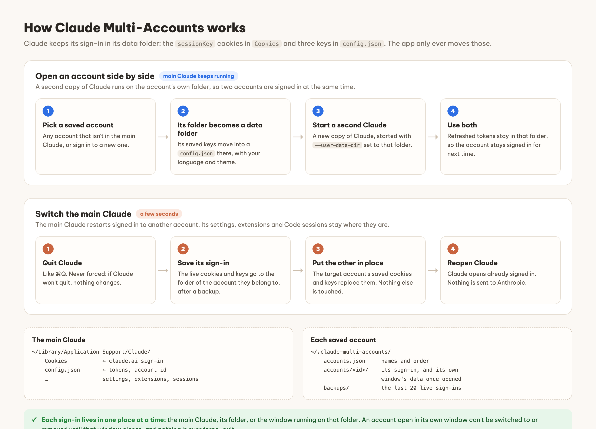
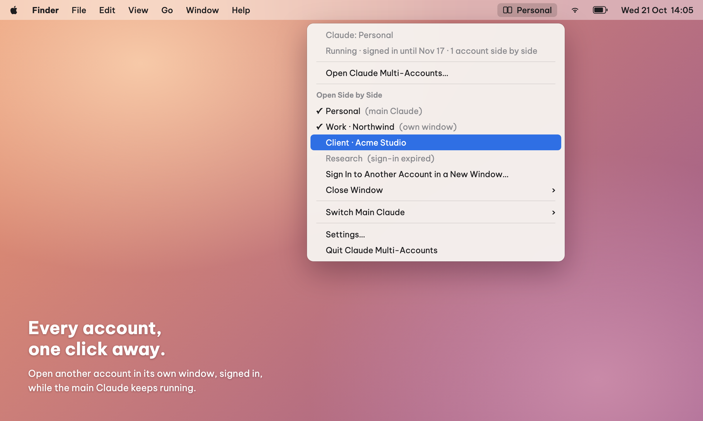
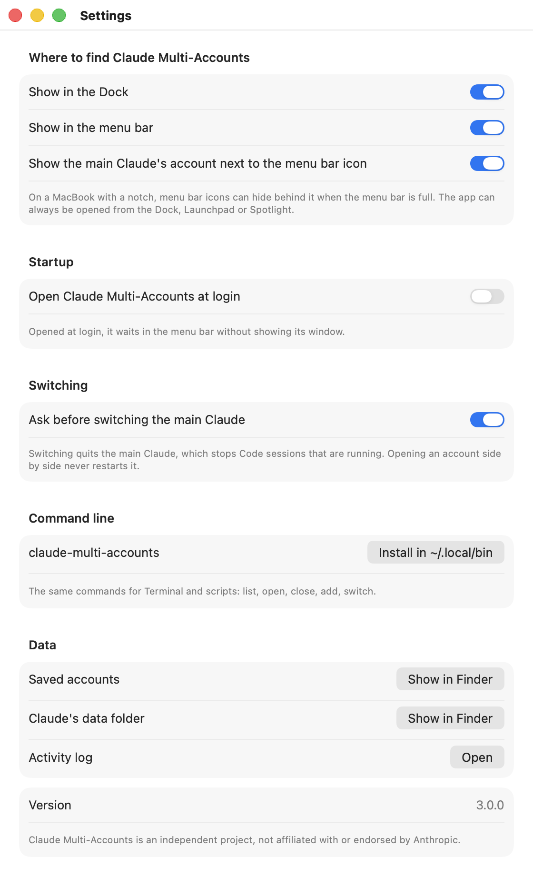
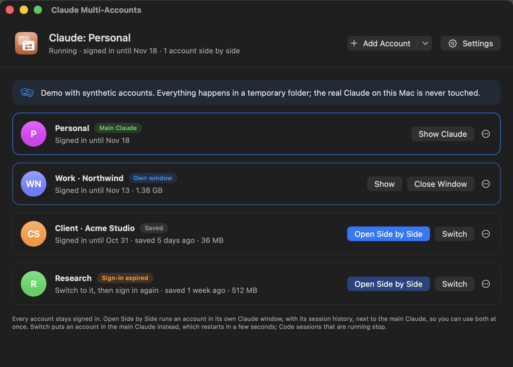

<p align="center"></p>

# Claude Multi-Accounts

**Stay signed in to all your Claude accounts and use them at the same time** in the **Claude desktop app** (including its Code tab) on one Mac. Each account opens in its own Claude window, already signed in, next to your main Claude. No logging out, no typing passwords, no signing back in.

<p align="center"></p>
<p align="center"><sub>Illustration with synthetic data.</sub></p>

- **Use several accounts at once.** Open any saved account in its own Claude window with one click: chat in one account while a Code session runs in another. The main Claude keeps running.
- **Every account stays signed in.** Sign in to each account once. After that the app keeps its sign-in ready, so opening it doesn't ask for a password. (Like any browser sign-in, one left unused for about 30 days expires.)
- **Switch the main Claude when you prefer one window.** It moves the main Claude to another account in a few seconds, for example when one account runs out of usage.

<p align="center"></p>

**macOS only** (macOS 13 or later, Apple silicon and Intel). It comes two ways, built from the same code:

- **Claude Multi-Accounts.app**: a window, a Dock icon and a menu bar item.
- **`claude-multi-accounts`**: the same thing on the command line.

> [!IMPORTANT]
> **Not affiliated with Anthropic.** Claude Multi-Accounts is an independent, unofficial project. It is not made, endorsed or supported by Anthropic. “Claude” is Anthropic's trademark and is named here only to say which app this tool works with. Use each of your accounts in line with Anthropic's terms. For help with Claude itself, contact Anthropic, not this project.

> [!WARNING]
> **Use at your own risk.** The app copies the sign-in files of the Claude desktop app and starts extra copies of Claude. It is written carefully (it backs up the live sign-in before every change, never force-quits Claude and stops when anything looks unexpected), but it comes with no warranty. See [LICENSE](LICENSE).

## Contents

- [What it can and can't do](#what-it-can-and-cant-do)
- [How it works](#how-it-works)
- [Install](#install)
- [Use](#use)
- [Demo](#demo)
- [Command line](#command-line)
- [Files, backups and uninstalling](#files-backups-and-uninstalling)
- [Upgrading from Claude Account Swap](#upgrading-from-claude-account-swap)
- [Good to know](#good-to-know)
- [Why not claude-swap?](#why-not-claude-swap)
- [Project layout and tests](#project-layout-and-tests)

## What it can and can't do

**Each account you open side by side runs in a second copy of Claude.** It gets its own Claude window on its own data folder, signed in, and the main Claude doesn't restart. Because it is a separate copy of Claude:

- it has **its own settings, connectors and extensions**, separate from the main Claude's. The account's **Code and Cowork session history comes with it**: those session lists move into its window while it is open and back to the main Claude when it closes;
- it **takes disk space**: Claude downloads its Code tools (about 0.5 GB) into that folder, and its Cowork virtual machine (several GB) if you use Cowork there. The app shows each account's folder size;
- **Claude in Chrome** doesn't pair with a side-by-side window (Claude turns its local pairing off when its data folder is moved), so use the browser extension with the main Claude;
- `claude://` links and clicks on Claude's Dock icon go to whichever copy macOS picks, usually the first one opened. Use the app or its menu to bring a window forward;
- both windows have the same Claude icon in the Dock; tell them apart by the account in each window.

**Switching restarts the main Claude.** Claude quits (like ⌘Q) and reopens signed in to the other account a few seconds later. Code sessions that are running stop; Claude keeps a separate session list per account, so you see the other account's sessions after switching, and your earlier ones come back when you switch back. If Claude asks to confirm quitting, confirm. If it won't quit, nothing changes.

**One sign-in lives in one place.** An account is either in the main Claude, in its own window, or saved. The app won't switch to an account, or remove it, while its window is open: it asks to close that window first. This keeps Claude's refreshed tokens from being split between two copies, which would sign the account out.

**Never use Claude's own Log out.** It tells Anthropic to end that sign-in, so the saved copy stops working and that account needs a fresh sign-in. Use **Add Account** instead.

**Sign-ins expire like any browser sign-in.** The claude.ai cookie lasts about 30 days and is renewed while you use the account. The app shows each account's expiry; if one expires, switch the main Claude to it and sign in again.

**It depends on where Claude keeps its files.** Claude has no official way to run several accounts, so this tool works with the files the desktop app uses today. Run `claude-multi-accounts doctor` after a Claude update: every line should say `ok`.

**The download isn't notarized by Apple**, so macOS shows a security warning the first time it opens. [First open](#first-open) explains why and how to open it.

## How it works

<p align="center"></p>

The desktop app keeps its sign-in in `~/Library/Application Support/Claude`:

| What | Where |
|------|-------|
| claude.ai web session | `Cookies` (the `sessionKey` cookie) |
| tokens the Code tab runs on | `config.json` keys `oauth:tokenCache`, `oauth:tokenCacheV2` |
| which account is signed in | `config.json` key `lastKnownAccountUuid` |

Both are encrypted with one key the app keeps in your Keychain (“Claude Safe Storage”). That key is the same for every account and every data folder on this Mac, so a saved sign-in works when a second Claude opens it, or when it is put back in the main Claude. The tool never decrypts or reads those values: it copies the cookie files and those three keys, leaving every other setting alone. Nothing is sent to Anthropic.

- **Side by side** starts another copy of Claude with `--user-data-dir` pointing at the account's own folder, `~/.claude-multi-accounts/accounts/<account>/`. Claude refreshes that account's tokens in that folder, so the account stays signed in for the next window or switch.
- **Switching** quits the main Claude, saves its sign-in into the folder of the account it belongs to (after a backup), puts the target account's sign-in in its place and opens Claude again.

The full rules and file formats are in [docs/how-it-works.md](docs/how-it-works.md).

## Install

You need macOS 13 or later and the [Claude desktop app](https://claude.ai/download), opened and signed in once.

1. Download **Claude-Multi-Accounts-…-macOS.zip** from the release.
2. Open the zip (Safari does it for you) and drag **Claude Multi-Accounts.app** into **Applications**.
3. Open Claude Multi-Accounts. The first time, macOS shows a security warning: see [First open](#first-open).
4. The window opens. [Name your first account](#first-time-setup).

To check a download, run `shasum -a 256 -c SHA256SUMS.txt` in the folder with the release's zip files and `SHA256SUMS.txt`.

### First open

macOS warns about every app Apple hasn't checked (notarized). Notarizing needs a paid Apple Developer account, which this free project doesn't have, so you see the warning once. It doesn't mean macOS found a problem with the app. All the source is in this repository; if you'd rather not trust the download, [build it yourself](#build-it-yourself).

**macOS 15 Sequoia and later, including macOS 26 Tahoe:**

1. Open the app. macOS says it can't verify that “Claude Multi-Accounts” is free of malware. Click **Done**, not Move to Trash.
2. Open **System Settings → Privacy & Security** and scroll to **Security**. Next to the line saying “Claude Multi-Accounts” was blocked, click **Open Anyway**.
3. Click **Open Anyway** again in the dialog, then confirm with your password or Touch ID.

**macOS 13 Ventura and 14 Sonoma:** in Finder, open **Applications**, Control-click (or right-click) **Claude Multi-Accounts**, choose **Open**, then click **Open** in the dialog.

**Any version, in Terminal:** this removes the “downloaded from the internet” mark that makes macOS check the app. Then open it as usual.

```bash
xattr -dr com.apple.quarantine "/Applications/Claude Multi-Accounts.app"
```

### The command line tool

The command is inside the app. In **Settings → Command line**, click **Install in ~/.local/bin**: it links `~/.local/bin/claude-multi-accounts` to the copy inside the app, so it updates with the app. If Terminal then says `command not found`, add that folder to your path and open a new Terminal window:

```bash
echo 'export PATH="$HOME/.local/bin:$PATH"' >> ~/.zshrc
```

The release also has **claude-multi-accounts-…-macOS.zip** with the command on its own. After unzipping it into `~/.local/bin`, run `xattr -c ~/.local/bin/claude-multi-accounts` so macOS doesn't block it.

### Build it yourself

You need Apple's developer tools for `swift`: Xcode, or the Command Line Tools (`xcode-select --install`). In this folder:

```bash
macos/scripts/install.sh
```

It builds the app and the command, installs `~/Applications/Claude Multi-Accounts.app`, links `~/.local/bin/claude-multi-accounts` to the command inside it, and opens the app. A copy you build on your own Mac opens without the security warning. To build without installing, run `macos/scripts/build.sh` (the result is in `macos/build/`).

## Use

### Opening the window

The window opens when you open the app. After that, get back to it any of these ways:

- click **Claude Multi-Accounts in the Dock**;
- open it from **Launchpad**, **Spotlight** (⌘ Space, type “Claude Multi-Accounts”) or **Applications**;
- click its icon in the **menu bar** and choose **Open Claude Multi-Accounts…**

Closing the window doesn't quit the app; it keeps the menu bar item up to date. To quit, choose **Claude Multi-Accounts → Quit** (⌘Q).

### First-time setup

1. The window shows the account the main Claude is signed in to and asks you to name it. Click **Name It…** and use something you'll recognise, such as your email.
2. Click **Add Account** to sign in to your next account. There are two ways:
   - **Sign In in a New Window…** (the default): a second Claude window opens at its sign-in screen while the main Claude keeps running. Sign in there with the other account. It joins the list, open side by side, within about half a minute of signing in (as soon as Claude has saved its sign-in).
   - **Sign In in the Main Claude (Restarts It)…**: Claude quits and reopens signed out; sign in with the other account. It is saved the first time you switch away from it.
3. Repeat for more accounts. This is the only time you sign in to each one.

### Using accounts side by side

Click **Open Side by Side** on a saved account. It opens in its own Claude window, signed in, next to the main Claude. Both run at once, each on its own account, and you can open as many accounts as you have.

On an account that is open side by side, **Show** brings its window forward and **Close Window** quits it (like ⌘Q in that window). Its sign-in stays in its folder, ready to open again or to switch the main Claude to.

If you close a new account's window before signing in, the app offers to open it again or discard it.

What to expect from a side-by-side window is listed under [What it can and can't do](#what-it-can-and-cant-do): your session history for that account, its own settings and disk space, and no Claude in Chrome pairing. An account can't be in the main Claude and in its own window at the same time; if that happens (say you signed in to the same account in both), the app warns and won't switch until that window is closed.

### Switching the main Claude

Click **Switch** on an account. Claude quits and reopens signed in to it a few seconds later. The app asks first, since running Code sessions stop; tick **Don't ask again** or turn it off in Settings. If the account is open in its own window, the app offers to close that window first.

Each account shows when its sign-in expires, when it was last saved and how much space its folder takes. The **⋯** button has **Rename…**, **Show Folder in Finder** and **Remove…** (which moves the account's folder to the Trash).

### The menu bar

<p align="center"></p>

The menu bar item shows the main Claude's account. Its menu lists every account: click one to open it in its own window, or to bring it forward if it is already open (open accounts are ticked). **Close Window** quits an account's window, and **Switch Main Claude** puts another account in the main Claude. The Dock icon's menu (Control-click) has the same list. The icon changes to two windows while an account is open side by side.

### Settings

<p align="center"></p>

Click **Settings** in the window (or ⌘,) to:

- show or hide the Dock icon, the menu bar item, and the account name next to the menu bar icon (with both icons off, open the app from Launchpad, Spotlight or Applications);
- open Claude Multi-Accounts at login (it then waits in the menu bar without a window);
- ask, or not, before switching the main Claude;
- install the `claude-multi-accounts` command;
- show the saved accounts, Claude's data folder or the activity log.

The app follows your Mac's light or dark appearance:

<p align="center"></p>

## Demo

To try the app, or show it, without your own accounts:

```bash
open -n "/Applications/Claude Multi-Accounts.app" --args --demo
```

The demo uses four synthetic accounts (“Personal”, “Work · Northwind”, “Client · Acme Studio”, “Research”) in a temporary folder. Every button works on that data, including side by side, switching and adding accounts (a pretend sign-in arrives two seconds after a window opens). The demo never starts Claude or touches its data, and keeps its settings separately. The screenshots in this README come from the demo; see [Screenshots](#screenshots).

## Command line

```bash
claude-multi-accounts list                      # accounts, where each one is open, sign-in expiry
claude-multi-accounts open Client               # open Client in its own window, next to the main Claude
claude-multi-accounts close Client              # quit Client's window
claude-multi-accounts add --window --name Lab   # sign in to another account in a new window
claude-multi-accounts switch                    # the main Claude to the next saved account
claude-multi-accounts switch Work               # by name, list number or uuid
claude-multi-accounts switch Work --close-window   # close Work's own window first, if open
claude-multi-accounts add                       # save the main account, reopen Claude signed out
claude-multi-accounts rename current "me@example.com"
claude-multi-accounts remove 3                  # its folder goes to the Trash
claude-multi-accounts doctor                    # check this Mac's Claude looks as expected
claude-multi-accounts paths                     # where everything is kept
```

`list --json` prints the same as JSON, for scripts. Running the command from a terminal inside Claude's own Code tab works: a switch runs in a detached process, so it finishes and reopens Claude even though quitting Claude ends that terminal. `~/.claude-multi-accounts/activity.log` records what each command did.

## Files, backups and uninstalling

Everything the app keeps is private to your user:

```
~/.claude-multi-accounts/
  accounts.json            names and order of your accounts
  accounts/<account>/      each account's saved sign-in; once opened side by side,
                           also that window's own Claude data
  backups/                 the live sign-in before each change (the last 20)
  activity.log             what each switch and window did
```

Every switch first copies the live sign-in to `backups/`, so a mistake can be undone by copying a backup back while Claude is quit. **Remove…** moves an account's folder to the Trash, where you can still get it back.

To uninstall: switch the main Claude to the account you want to keep, quit Claude Multi-Accounts and delete it, then:

```bash
rm -rf ~/.local/bin/claude-multi-accounts ~/.claude-multi-accounts ~/.claude-desktop-swap
```

Deleting `~/.claude-multi-accounts` forgets the saved sign-ins and the side-by-side windows' data (`~/.claude-desktop-swap` is only there if you upgraded from Claude Account Swap). Claude stays signed in to the main account.

## Upgrading from Claude Account Swap

Up to version 2 this app was called **Claude Account Swap**, with the command `claude-desktop-swap`. Version 3 renames it and puts using accounts side by side first; what it does is otherwise the same, and your saved accounts and settings carry over.

- **The app** is now **Claude Multi-Accounts.app**. `macos/scripts/install.sh` removes `~/Applications/Claude Account Swap.app`; if you installed from a release, drag the old app to the Trash.
- **The command** is now `claude-multi-accounts`. `install.sh` removes the old `~/.local/bin/claude-desktop-swap` link; otherwise click **Install in ~/.local/bin** in Settings, which also removes the old link once the old app is gone.
- **The folder** `~/.claude-desktop-swap` moves to `~/.claude-multi-accounts` by itself, as soon as no account is open in its own window, and its `swap.log` becomes `activity.log`. Until then the app keeps using it where it is. A link is left at the old path so that anything still using it finds the new folder; leave it in place.

Coming from version 1 (the Python script with an AppleScript picker): your saved accounts keep working. An account's folder changes format the first time it is opened side by side (its `auth.json` becomes a `config.json`), which version 1 can't read.

## Good to know

- **The terminal `claude` CLI has its own login** (the Keychain item `Claude Code-credentials`), which this tool leaves alone. For the CLI and VS Code, use [claude-swap](https://github.com/realiti4/claude-swap) (`cswap switch`).
- **Quitting Claude:** the app asks the one copy of Claude it means to quit, as the Dock does, and falls back to the ordinary quit signal Claude also gets when the Mac shuts down. It never force-quits.
- **Activity log:** `~/.claude-multi-accounts/activity.log`, or **Settings → Activity log**.
- **After a Claude update**, run `claude-multi-accounts doctor`.

## Why not claude-swap?

[realiti4/claude-swap](https://github.com/realiti4/claude-swap) swaps the Claude Code CLI's login (the `Claude Code-credentials` Keychain item plus `oauthAccount` in `~/.claude.json`). The desktop app ignores both. It passes its own login to every Code tab session, so `cswap switch` has no effect there. This tool borrows claude-swap's key ideas:

- save the live login before replacing it, so rotated tokens aren't lost;
- never log out, because logging out revokes the login on the server;
- refuse to change files while the app is running;

and applies them to the files the desktop app actually uses, adding side-by-side windows so several accounts run at once.

## Project layout and tests

```
macos/              the app and the command (a Swift package), its build scripts and tests
docs/               how side-by-side windows and switching work, and the file formats
docs/screenshots/   the README images and how to make them again
assets/icon/        the app icon: the SVG master and the script that exports it
```

Building and testing are described in [macos/README.md](macos/README.md):

```bash
cd macos
swift test                                            # the account logic, with a pretend Claude
swift build && /usr/bin/python3 -m unittest discover -s Tests/cli -v   # the command, end to end
```

### Screenshots

Every image in this README uses synthetic data only. The app draws its own windows from the demo; the menu bar, side-by-side and how-it-works images are HTML in [`docs/screenshots/src`](docs/screenshots/src). To make them all again:

```bash
docs/screenshots/make-screenshots.sh
```

## License

[MIT](LICENSE). The software is provided “as is”, without warranty of any kind.
